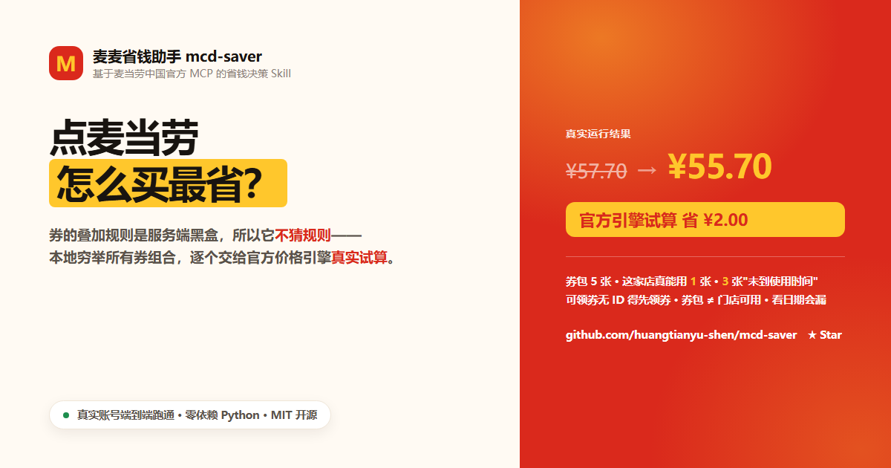

# 🍟 麦麦省钱助手 (mcd-saver)

> 一个基于**麦当劳中国官方 MCP 服务**的 AI Skill —— 把"怎么买麦当劳最便宜"从**感觉**变成**算得清**。
>
> 「麦当劳程序员创意开发大赛」参赛作品 · 使用腾讯 WorkBuddy 开发

**赛事主页**：<https://github.com/M-China/mcd-developer-innovation-challenge>
**宣传页（图表版，30 秒看懂）**：<https://huangtianyu-shen.github.io/mcd-saver/>

<a href="https://huangtianyu-shen.github.io/mcd-saver/">
  
</a>

| 参赛材料 | 文件 |
|---|---|
| 项目介绍（必须） | 本文件 `README.md` |
| 参赛声明（必须，内容不可改动） | [`CONTEST_DECLARATION.md`](CONTEST_DECLARATION.md) |
| MCP 接入说明（必须） | [`MCP_INTEGRATION.md`](MCP_INTEGRATION.md) |
| WorkBuddy 专项奖励材料 | [`workbuddy.md`](workbuddy.md) |

---

⭐ **如果这个项目对你有用，请点个 Star** —— 比赛排名依据公开 Star 数，
**Star 为 0 不进排行榜**。你的一个 Star 就是对这个项目的全部支持。
拉票文案见 [`PROMOTION.md`](PROMOTION.md)（请勿刷量，违规将取消参赛资格）。

---

---

## 这是什么

麦当劳的省钱资源散落在**四个互不相通的池子**里：麦麦省可领券、门店可用券、会员积分、限时活动。
用户看不全、算不清，所以总是在多花钱。

**麦麦省钱助手**把它们收敛成一条可执行的决策链：

```
能领的券先领光  →  用官方价格引擎试算找最低实付  →  积分按"每分价值"花掉  →  在活动期下手
    领                      算                            换                      择时
```

### 核心差异点：不猜规则，只做试算

麦当劳的券叠加规则、门槛判定、可用性校验都在**服务端黑盒**里。
任何本地写死的规则推算，都会和真实结算价对不上。

所以本 Skill 的做法是——

> **本地穷举搜索，服务端权威定价。**

本地把候选方案（单券 / 多券组合 / 凑单）**穷举 + 剪枝**出来，
然后逐个调用官方的 `calculate-price` **真实试算**，取最低实付。这是人工做不到的部分。

---

## 它能做什么

| 能力 | 说明 |
|---|---|
| 🎁 **一键领券 + 券包体检** | 领光麦麦省所有可领券；并告诉你"券包 N 张，本店这个场景只真能用 M 张，还有 K 张没到使用时间" |
| 🧮 **券组合试算** | 穷举单券/组合/凑单方案，用官方价格引擎逐个真实试算，输出最低实付方案对照表 |
| ➕ **凑单净收益** | 满减差一点达标时，算清"再加一件还净省多少钱"；买赠差件时提示"实付不变多得一件" |
| 🪙 **积分价值排序** | 用"元/积分"统一尺子给所有兑换项排序；抽奖用**盈亏平衡线**判断值不值 |
| ⏰ **过期优先级** | 快过期积分优先花掉（归零价值为 0） |
| 📅 **活动择时** | 结合活动日历判断"现在买还是再等等" |
| 📊 **省钱日报** | 把以上全部渲染成一份 HTML 日报 |

---

## 快速开始

### 1. 申请麦当劳 MCP Token

访问 👉 **https://open.mcd.cn/mcp**

1. 右上角【登录】→ 手机号验证码登录
2. 登录后点右上角【控制台】
3. 点【激活】申请 MCP Token
4. 同意服务协议 → 复制 Token

### 2. 配置 MCP 连接

**接入地址**：`https://mcp.mcd.cn`
**传输协议**：Streamable HTTP
**鉴权**：请求头 `Authorization: Bearer <你的 MCP Token>`

```json
{
  "mcpServers": {
    "mcd-mcp": {
      "type": "streamablehttp",
      "url": "https://mcp.mcd.cn",
      "headers": {
        "Authorization": "Bearer YOUR_MCP_TOKEN"
      }
    }
  }
}
```

- **WorkBuddy**：连接器（Connector）→ 添加自定义 MCP → 粘贴上面的 JSON → 信任该服务
- **Cursor**：设置 → Tools & MCP → Add Custom MCP
- **Cherry Studio**：设置 → MCP → 添加 → 从 JSON 导入

### 3. 安装 Skill

```bash
# 用户级（所有项目可用）
cp -r mcd-saver ~/.workbuddy/skills/mcd-saver
```

### 4. 开始用

在 AI 对话里直接说：

- "麦当劳有什么优惠，帮我领券"
- "我想吃辣堡，怎么买最便宜"
- "我有几张券，怎么用最划算"
- "积分快过期了，怎么花"

---

## 命令行用法（不依赖 IDE 也可跑）

```bash
export MCD_MCP_TOKEN=你的Token

# 一条命令跑完整个决策链，输出省钱日报
python scripts/daily_scan.py --city 上海市 --keyword 人民广场 --out 省钱日报.html

# 加 --claim 会执行一键领券（写操作，默认关闭）
python scripts/daily_scan.py --city 上海市 --keyword 人民广场 --claim

# 指定购物车（商品code:数量）
python scripts/daily_scan.py --city 上海市 --keyword 人民广场 --cart 9900004064:2,521950:1
```

独立脚本：

```bash
python scripts/mcp_client.py tools                        # 列出全部 35 个 MCP 工具
python scripts/mcp_client.py call available-coupons       # 直接调用任意工具
python scripts/coupon_optimizer.py --input plan.json      # 券组合优化
python scripts/points_advisor.py --input points.json      # 积分价值评估
python scripts/saving_report.py --input bundle.json       # 渲染日报
python scripts/coupon_optimizer.py --self-test            # 内置自检
```

---

## 项目结构

```
mcd-saver/
├── SKILL.md                          # Skill 主文件（工作流 + 铁律）
├── README.md                         # 项目介绍（参赛必须）
├── CONTEST_DECLARATION.md            # 参赛声明（参赛必须，官方原文）
├── MCP_INTEGRATION.md                # MCP 接入说明（参赛必须）
├── workbuddy.md                      # WorkBuddy 开发上下文（专项奖励）
├── PROMOTION.md                      # 各社区宣传文案（非参赛材料）
├── docs/
│   └── index.html                    # 在线宣传落地页（GitHub Pages，单文件）
├── examples/                         # 可运行样例
├── references/
│   ├── mcp-tools.md                  # 35 个 MCP 工具全表（实测）
│   ├── data-shapes.md                # 真实返回结构样本（实测抓取）
│   ├── saving-playbook.md            # 省钱打法手册
│   └── _raw_tools_schema.json        # 工具的完整 JSON Schema
├── scripts/
│   ├── mcp_client.py                 # 轻量 MCP 客户端（零依赖，可独立运行）
│   ├── coupon_optimizer.py           # ⭐ 核心：券组合试算优化器
│   ├── points_advisor.py             # 积分"每分价值"顾问
│   ├── saving_report.py              # 省钱日报渲染器
│   └── daily_scan.py                 # 一键端到端流水线
└── assets/
    ├── report.css                    # 日报样式
    ├── share-card.png                # 横版分享卡 1200×630
    └── poster-xiaohongshu.png        # 竖版海报 1080×1440
```

---

## 效果示例（真实运行）

对上海某门店的一次真实运行：

```
服务端时间  2026-10-10 13:47（周六）
门店        麦当劳上海黄浦华旭国际大厦餐厅（1450713）
券包        5 张 | 本店当前场景可用 1 张 | 3 张"未到使用时间"
积分        0

演示购物车  麦咖啡冰美式中杯 11.90 + 鸡薯双全盒 15.90 + 龙焰芝士棒鸡腿堡三件套 29.90
            不用券基准              57.70 元
            「9.9元中杯冰美式」券价   9.90 元（原 11.90）
            官方引擎真实试算实付      55.70 元   ✅ 省 2.00 元
```

> 本地估算 55.70，与官方引擎返回的 55.70 完全一致 —— 验证了"本地搜索 + 服务端定价"这条链路成立。

---

## 三个实测发现（也是本项目的价值所在）

这三点是开发过程中**真实踩到**的，官方文档里没写清楚，但对"能不能真正省到钱"至关重要：

### 1️⃣ `available-coupons` 的券**不能直接用来下单**

它只返回 `couponName` + `couponImage`，**没有 `couponId` / `couponCode`**。
拿去试算会被服务端拒绝：`使用优惠券需要couponId和couponCode`。

→ 必须先 `auto-bind-coupons` 领进券包，再从 `query-my-coupons` 取带 ID 的券对象。

### 2️⃣ 券包里的券 **≠ 这个门店能用**

`query-my-coupons` 不做门店、渠道校验，只说明"你拥有它"。
实测：券包 5 张，在指定门店的到店自取场景下**只有 1 张真正可用**。

→ 必须用 `query-store-coupons` 校验。这是"有券却用不掉"的根本原因。

### 3️⃣ 券可能"未到使用时间"，且**只有 labels 会告诉你**

券对象的 `instructions.labels[].text` 会直接标注"未到使用时间"。
实测 3 张套餐券的 `tradeStartDate` 是明天/下周，标签明确写着"未到使用时间"。

→ 只看有效期会误判，必须读 labels。

---

## 技术要点

- **零第三方依赖**：全部脚本仅用 Python 标准库，`python3 scripts/xxx.py` 直接跑。
- **MCP Streamable HTTP 客户端**：自己实现了 `initialize → notifications/initialized → tools/list → tools/call`，
  并兼容纯 JSON 与 SSE 两种响应体（实测服务端两种都会返回）。
- **单位陷阱处理**：服务端金额字段单位是**分**，展示层统一换算为元，
  但传给接口时保持"分"，避免双重换算。
- **业务错误 vs 协议错误**：麦当劳的业务失败走 `success:false` + `code` + `message`（如 `600012 每单限购1件`），
  不是 MCP 协议错误，不能当网络故障重试。
- **每一个脚本都带 `--self-test`**：内置样例 + 断言，改代码后一条命令回归。

---

## 免责声明

- 本项目为参加「麦当劳程序员创意开发大赛」的**个人非商业作品**，由参赛者独立开发，
  **非麦当劳官方产品，亦非 WorkBuddy 官方产品**。
- **数据来源**：全部数据通过麦当劳中国官方 MCP 服务（`https://mcp.mcd.cn`）实时获取，
  不使用任何未公开的内部接口或数据。
- **商标**：「麦当劳」「McDonald's」「麦麦省」「麦乐送」等商标及标识归其权利人所有，
  本项目不构成任何授权，不暗示官方背书。
- **准确性**：所有优惠信息、价格与可用性，以麦当劳官方渠道及官方
  `calculate-price` 引擎的实时返回为准；本项目输出仅供参考。
- **安全边界**：本项目**不会**在未经用户确认的情况下执行下单、取消订单、
  积分抽奖等消费型操作；不在未经确认的情况下动用用户资金。
- **凭据**：使用者需自行申请并保管 MCP Token，**切勿将 Token 提交到公开仓库**。
  本仓库仅提供 `.env.example` 占位，不含任何真实凭据。

---

## 许可

MIT License · 详见 [LICENSE](LICENSE)

© 2026 McDonald's 相关商标归其权利人所有。
